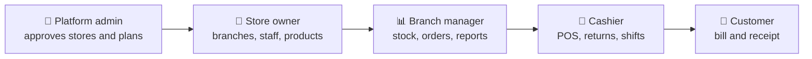

# 🛒 Multi-Tenant POS System

*One platform. Many stores. Every sale counted.*

---

## 📅 Weekly Plan

> [!IMPORTANT]
> **10-week plan, starting Monday 6 July 2026.** Redux Toolkit is fully done by Subhash and Vrushay, and every frontend module is complete. **A new assignment is coming soon**, and the plan will be updated when it is announced.

| Week | Dates (2026) | Focus | Owners | Status today | Report |
| --- | --- | --- | --- | --- | --- |
| **Week 1** | 6 to 12 Jul | Setup, backend upload, roles, folder structure, GitHub training | Subhash, Vrushay | ✅ Done | [Week 1](reports/04-weekly-progress/week-01/README.md) |
| **Week 2** | 13 to 19 Jul | Design diagrams and Redux Toolkit, fully done: part 1 Vrushay, part 2 Subhash | Vrushay, Subhash | ✅ Done | [Week 2 update](reports/04-weekly-progress/week-02/README.md) |
| **Week 3** | 20 to 26 Jul | Frontend: Super Admin module, login and onboarding | Vrushay (Super Admin), Tanya (onboarding) | ✅ Done |  |
| **Week 4** | 27 Jul to 2 Aug | Frontend: Store module (the largest, 11 pages) | Tanya | ✅ Done |  |
| **Week 5** | 3 to 9 Aug | Frontend: Branch Manager and Cashier modules | Vishvas (Branch Manager), Vimal (Cashier) | ✅ Done |  |
| **Week 6** | 10 to 16 Aug | Testing: Postman report and 96 test cases done, results to record, bug fixes | Vrushay with the whole team | 🔄 In progress |  |
| **Week 7** | 17 to 23 Aug | New assignment, coming soon | Team | 🆕 Coming soon |  |
| **Week 8** | 24 to 30 Aug | Payments, code quality, SRS and documentation | Team | ⏳ Planned |  |
| **Week 9** | 31 Aug to 6 Sep | Presentation and viva preparation | Team | ⏳ Planned |  |
| **Week 10** | 7 to 13 Sep | Final demo and submission | Team | ⏳ Planned |  |

To add a week, copy `reports/04-weekly-progress/WEEK_TEMPLATE.md` to `week-0N/README.md`, fill it in, and link it in this table.

---

## ⚡ The idea in 30 seconds

Most small shops run on a notebook, a calculator and a lot of memory. Chains with several branches have it worse: nobody sees stock, sales or staff in one place.

We built a point of sale platform that fixes this. A store owner signs up, picks a plan, adds branches and staff, and starts selling. Cashiers ring up orders at a POS screen. Managers watch stock and sales as they happen. A platform admin keeps the whole system healthy. Every store lives on the same platform, and none of them can see another store's data.



## 🎬 A day in the life

- **9:00** The platform admin opens the dashboard, sees a new store waiting for approval, and approves it.
- **9:15** The store owner adds a branch, creates categories and products, and invites a branch manager and a cashier.
- **10:00** The branch manager sets the opening stock for each product.
- **10:30** The cashier starts a shift, scans items, applies a discount, takes a UPI payment and prints the bill.
- **14:00** A customer returns an item, and the cashier records the refund against the original order.
- **18:00** The cashier ends the shift and gets a summary of sales, refunds and payment types. The manager checks the day's charts.

## 🧭 Who uses it

| Role | Where they work | What they do |
| --- | --- | --- |
| `ROLE_ADMIN` | `/super-admin` | Approve stores, manage subscription plans, watch the platform |
| `ROLE_STORE_ADMIN` | `/store` | Own the store, subscribe to a plan, manage branches, staff and products |
| `ROLE_STORE_MANAGER` | `/store` | Manage staff, categories, products and stock |
| `ROLE_BRANCH_ADMIN`, `ROLE_BRANCH_MANAGER` | `/branch` | Run a branch: orders, refunds, inventory, employees, reports |
| `ROLE_BRANCH_CASHIER` | `/cashier` | Sell, return, look up customers, track shifts |
| `ROLE_CUSTOMER` | not yet | Defined in the code, no dashboard yet |

After login, the app reads the role and shows only that role's pages. Everything else is a "page not found".

## 🏗️ Where we are

| Area | Status | Built by |
| --- | --- | --- |
| Spring Boot backend, 19 modules | ✅ Done | Backend upload by Vrushay |
| Redux Toolkit, 22 features and the global store | ✅ Done | Vrushay (part 1) and Subhash (part 2) |
| Super Admin module, 6 pages | ✅ Done | Vrushay |
| Store module, 11 pages | ✅ Done | Tanya |
| Branch Manager module, 9 pages | ✅ Done | Vishvas |
| Cashier module, 5 pages | ✅ Done | Vimal |
| Postman testing report and 96 test cases | ✅ Written, results to record | Vrushay |
| UML, ER and architecture diagrams, 20 of them | ✅ Done | Vrushay |
| SRS in IEEE format | ⏳ Planned | Team |
| New assignment | 🆕 Coming soon | Team |

### By the numbers

| 22 | 7 | 31 | 19 | 96 | 20 |
| --- | --- | --- | --- | --- | --- |
| Redux features | roles | frontend pages | backend modules | test cases | diagrams |

## 🧰 Tech stack

| Part | Technology |
| --- | --- |
| Backend | Spring Boot, Spring Security with JWT, JPA / Hibernate, Maven, Spring Mail |
| Database | MySQL |
| Payments | Razorpay and Stripe |
| Frontend | React 19, Vite 7, Tailwind CSS 4, shadcn/ui (Radix), React Router 7 |
| State and API | Redux Toolkit, Axios |
| Charts and bills | Recharts, @react-pdf/renderer |
| API testing | Postman |

## 🗺️ Repository map

```
billing-system/
├── pos-backend/          Spring Boot backend (package com.zosh)
├── pos-frontend-vite/    React + Vite frontend
│   └── src/
│       ├── pages/        one folder per role
│       ├── routes/       one route file per role
│       ├── Redux Toolkit/   globleState.js and features/<name>/
│       └── utils/        API client and helpers
├── reports/              everything we hand in
│   ├── 01-idea-abstract/   02-srs/   03-design/
│   ├── 04-weekly-progress/ 05-implementation/   06-testing/
│   └── 07-presentation/    08-demo-viva/   09-timeline/
└── README.md             you are here
```

## 🚀 Run it

**Backend**
```bash
cd pos-backend
./mvnw spring-boot:run
```
You need a JDK and MySQL. Put your own database values in `src/main/resources/application.yml` and never commit real passwords or keys. The API runs at `http://localhost:5000`.

**Frontend**
```bash
cd pos-frontend-vite
npm install
npm run dev
```
It opens at `http://localhost:5173`. The API address is set in `src/utils/api.js`.

## 👥 Team and frontend modules

| Member | GitHub | Frontend work | Pages | Status |
| --- | --- | --- | --- | --- |
| Vrushay Bohra | bohra0022 | Redux Toolkit part 1, Super Admin module, routing, Postman testing and reports | 11 Redux features, 6 Super Admin pages | Done |
| Subhash Dhaka | subhash8729 | Repository and folder structure, Redux Toolkit part 2 and `globleState.js` | 11 Redux features and the global store | Done |
| Vimal Kumar | iamvkb7 | Cashier module | 5 pages: create order, orders, returns, customers, shift summary | Done |
| Vishvas Choubisa | choubisavishvas-web | Branch Manager module | 9 pages: dashboard, orders, refunds, transactions, inventory, employees, customers, reports, settings | Done |
| Tanya Singh | tanyasingh077 | Store module (the largest) and onboarding | 11 pages: dashboard, branches, categories, employees, products, stores, sales, reports, upgrade, settings, alerts | Done |

The detailed log of who built what is in `reports/04-weekly-progress/frontend_work_log.md`.

## 🤝 How we work together

Five habits keep five people from stepping on each other:

1. **Pull before you start, and again before you push:** `git pull --rebase origin main`.
2. **Stay in your lane.** Each person edits their own folder in `pages/`.
3. **Shared files need a heads-up.** Tell the team before touching `README.md`, `package.json`, `globleState.js` or `routes/`.
4. **Never force-push `main`.** It changes every commit hash for everyone.
5. **Write commits like a story:** `type(scope): what changed`, for example `feat(redux): add order slice and thunks`.

## 📚 Reports

| What | Where |
| --- | --- |
| Idea and abstract | `reports/01-idea-abstract/PROJECT_IDEA_AND_ABSTRACT.md` |
| Features and tech stack | `reports/05-implementation/FEATURES_AND_TECH_STACK.md` |
| Diagrams | `reports/03-design/` |
| Postman API testing | `reports/06-testing/POSTMAN_TESTING_API.md` |
| Timeline | `reports/09-timeline/TIMELINE.md` |
| Weekly reports | `reports/04-weekly-progress/` |
| Who built what | `reports/04-weekly-progress/frontend_work_log.md` |
| Commit log | `reports/04-weekly-progress/commit_log.csv` |

## 🔧 Things we know we should fix

- Logout removes the `token` key, but login stores `jwt`.
- The API address is hardcoded in `src/utils/api.js` and should come from an environment variable.
- `package.json` lists `rechart` by mistake. The real package is `recharts`.
- The Commissions and Exports pages use sample data, and Exports has no route yet.
- Public signup accepts a `role` field, so the backend should reject admin roles.
