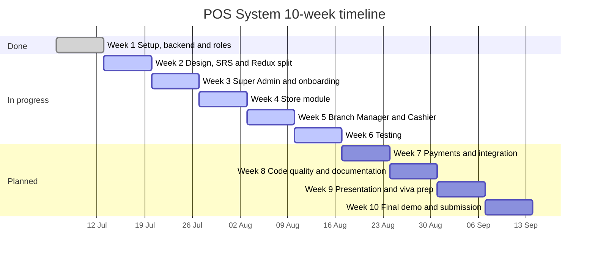

# Project Timeline: Multi-Tenant POS System

The project runs for 10 weeks, planned from Monday 6 July 2026. Weeks 1 to 6 show the owners and include testing. The Status column shows where the work stands today. The editable version, with week dates calculated from the start date, is in `Project_Timeline.xlsx` in this folder.

## Timeline chart

## Week by week

| Week | Dates | Focus | Owners | Status |
| --- | --- | --- | --- | --- |
| 1 | 6 to 12 Jul | Setup, backend upload, roles, folder structure, GitHub training | Subhash, Vrushay | Done |
| 2 | 13 to 19 Jul | Design diagrams, SRS, Redux Toolkit split (part 1 Vrushay, part 2 Subhash) | Vrushay, Subhash | In progress |
| 3 | 20 to 26 Jul | Frontend: Super Admin module, login and onboarding | Subhash, Vrushay, Tanya (onboarding) | In progress |
| 4 | 27 Jul to 2 Aug | Frontend: Store module (the largest, 11 pages) | Tanya | In progress |
| 5 | 3 to 9 Aug | Frontend: Branch Manager and Cashier modules | Vishvas (Branch Manager), Vimal (Cashier) | In progress |
| 6 | 10 to 16 Aug | Testing: Postman run, 96 test cases, results, bug fixes | Vrushay with the whole team | In progress |
| 7 | 17 to 23 Aug | Payments, subscriptions and API integration | Team | Planned |
| 8 | 24 to 30 Aug | Code quality, fixes and documentation | Team | Planned |
| 9 | 31 Aug to 6 Sep | Presentation and viva preparation | Team | Planned |
| 10 | 7 to 13 Sep | Final demo and submission | Team | Planned |

## Frontend modules

| Member | GitHub | Module | Pages |
| --- | --- | --- | --- |
| Vrushay Bohra | bohra0022 | Redux Toolkit part 1, Super Admin (with Subhash) | 11 Redux features |
| Subhash Dhaka | subhash8729 | Redux Toolkit part 2, Super Admin (with Vrushay) | 6 pages |
| Vimal Kumar | iamvkb7 | Cashier | 5 pages |
| Vishvas Choubisa | choubisavishvas-web | Branch Manager | 9 pages |
| Tanya Singh | tanyasingh077 | Store and onboarding | 11 pages |

The detailed log is in `reports/04-weekly-progress/frontend_work_log.md`.

## Completed so far

| Item | Evidence |
| --- | --- |
| Team repo and report folders | `80c721c`, `4584088` |
| Spring Boot backend uploaded | `ef6144e` |
| Idea, abstract and objectives | see `commit_log.csv` |
| Features, modules and tech stack | `13dc390` |
| Frontend folder structure | `ddf392b`, `751e82d` (subhash8729) |
| Frontend config, API client and utils | `dbcae3a` |
| Redux Toolkit part 1 (11 features) | `7ab1196` to `9809d35` |
| Commit log | `046f470`, `67e0b4c`, `8360f7e` |
| Postman testing report, 2 parts | `9e2ca1a`, `8172cb7` |
| UML, ER and architecture diagrams | `11645a2` |
| README with weekly plan | `b0ebffe`, `b4bee2d` |
| 10-week timeline and tracker | `75398a4`, `28069ac`, `65daf38` |
| Week 1 report and template | `4430a3c`, `7ce4830` |
| Branch Manager pages (customers, dashboard, cashier performance) | `3197520`, `bb95311`, `db9c60b` (choubisavishvas-web) |

Made but not committed yet: the API test case sheet (96 cases).
In progress: Cashier module (Vimal Kumar), Store module and onboarding (Tanya Singh), Branch Manager module (Vishvas Choubisa), Super Admin module and Redux Toolkit part 2 with `globleState.js` (Subhash Dhaka and Vrushay Bohra).

## Marks status

| Component | Marks | Status |
| --- | --- | --- |
| Idea & Abstract | 5 | Done |
| SRS / Documentation | 10 | Not started |
| Design (Use-case, Class, ER) | 10 | Done, diagrams committed |
| Weekly Progress | 25 | Ongoing, updated every week |
| Implementation & Code Quality | 20 | In progress |
| Testing | 10 | Report and 96 test cases written, results to record |
| Presentation | 10 | Not started |
| Demo & Viva | 10 | Not started |
