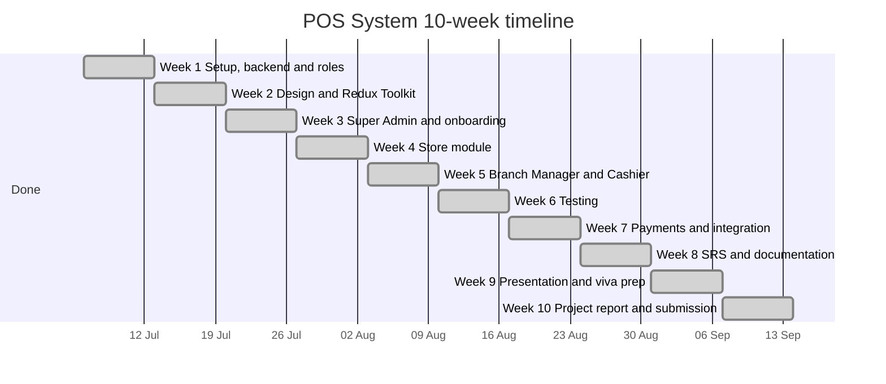

# Project Timeline: Multi-Tenant POS System

The project runs for 10 weeks, planned from Monday 6 July 2026. All 10 weeks are done. The editable version, with week dates calculated from the start date, is in `Project_Timeline.xlsx` in this folder.

## Timeline chart

## Week by week

| Week | Dates | Focus | Owners | Status |
| --- | --- | --- | --- | --- |
| 1 | 6 to 12 Jul | Setup, backend upload, roles, folder structure, GitHub training | Subhash, Vrushay | Done |
| 2 | 13 to 19 Jul | Design diagrams and Redux Toolkit, fully done: part 1 Vrushay, part 2 Subhash | Vrushay, Subhash | Done |
| 3 | 20 to 26 Jul | Frontend: Super Admin module (26 commits), login and onboarding | Vrushay (Super Admin), Tanya (onboarding) | Done |
| 4 | 27 Jul to 2 Aug | Frontend: Store module (the largest, 11 pages) | Tanya | Done |
| 5 | 3 to 9 Aug | Frontend: Branch Manager and Cashier modules | Vishvas (Branch Manager), Vimal (Cashier) | Done |
| 6 | 10 to 16 Aug | Testing: Postman report and 96 test cases | Vrushay with the whole team | Done |
| 7 | 17 to 23 Aug | Payments, subscriptions and API integration | Team | Done |
| 8 | 24 to 30 Aug | SRS and documentation | Team | Done |
| 9 | 31 Aug to 6 Sep | Presentation and viva preparation | Team | Done |
| 10 | 7 to 13 Sep | Final project report and submission | Team | Done |

## Frontend modules

| Member | GitHub | Module | Pages |
| --- | --- | --- | --- |
| Vrushay Bohra | bohra0022 | Redux Toolkit part 1, Super Admin | 11 Redux features, 6 pages |
| Subhash Dhaka | subhash8729 | Folder structure, Redux Toolkit part 2 | 11 Redux features and `globleState.js` |
| Vimal Kumar | iamvkb7 | Cashier | 5 pages |
| Vishvas Choubisa | choubisavishvas-web | Branch Manager | 9 pages |
| Tanya Singh | tanyasingh077 | Store and onboarding | 11 pages |

The detailed log is in `reports/04-weekly-progress/frontend_work_log.md`.

## Completed so far

| Item | Where |
| --- | --- |
| Team repo, report folders, backend upload | Week 1 report |
| UML, ER and architecture diagrams | `reports/03-design/` |
| Redux Toolkit, 22 features and the global store (Vrushay and Subhash) | `pos-frontend-vite/src/Redux Toolkit/` |
| Super Admin module (Vrushay Bohra) | `pages/SuperAdminDashboard/` |
| Store module and onboarding (Tanya Singh) | `pages/store/`, `pages/onboarding/` |
| Branch Manager module (Vishvas Choubisa) | `pages/Branch Manager/` |
| Cashier module (Vimal Kumar) | `pages/cashier/` |
| Postman testing report and 96 test cases | `reports/06-testing/` |
| Requirements specification (SRS) | `reports/02-srs/` |
| POS system documentation | `reports/05-implementation/` |
| Report presentation | `reports/07-presentation/` |
| Viva questions | `reports/08-demo-viva/` |
| Project report | `reports/10-project-report/` |

A new assignment is coming soon.

## Marks status

| Component | Marks | Status |
| --- | --- | --- |
| Idea & Abstract | 5 | Done |
| SRS / Documentation | 10 | Done |
| Design (Use-case, Class, ER) | 10 | Done, diagrams committed |
| Weekly Progress | 25 | Ongoing, updated every week |
| Implementation & Code Quality | 20 | In progress |
| Testing | 10 | Report and 96 test cases written, results to record |
| Presentation | 10 | Done |
| Demo & Viva | 10 | Started, viva questions written, demo to present |
